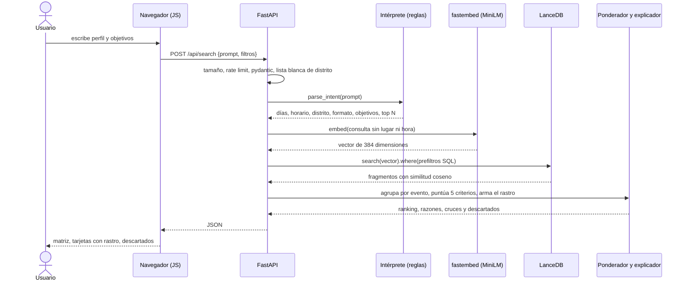

# Brújula Tech Week

Recomendador de eventos de **Perú Tech Week 2026** (12–18 oct, Lima). Escribes quién eres y qué buscas; un buscador vectorial **100 % local** elige los eventos y muestra, paso a paso, por qué.


- **Búsqueda semántica local:** LanceDB + embeddings multilingües (`fastembed`, ONNX). Sin API keys, sin GPU, y el texto del usuario no sale del servidor.
- **Razonamiento visible:** cada evento recibe nota en 5 criterios con pesos que se adaptan a tu prompt. Ves la matriz, el rastro `[SEM] [OBJ] [DISP] [ESC] [LOG]`, los choques de horario y los eventos descartados con su motivo.
- **Cupos y agotados** vienen de Luma, no de un modelo.
- **Seguridad y coste pensados desde el inicio:** ver [SECURITY.md](docs/SECURITY.md) y [Costes](#costes).

Documentación: [Arquitectura](docs/ARCHITECTURE.md) · [Cómo se construyó, paso a paso](docs/BUILD_STEPS.md) · [Modelo de amenazas](docs/SECURITY.md)

## Stack

| Capa | Herramienta | Función |
|---|---|---|
| Lenguaje y paquetes | **Python 3.12** · **uv** | Entorno reproducible con `uv.lock` |
| Datos | `httpx` · **Crawl4AI** (opcional) | Scraping de Luma, con o sin navegador y sesión |
| Embeddings | **fastembed** · `paraphrase-multilingual-MiniLM-L12-v2` | Texto → vector de 384 dimensiones, ONNX INT8 |
| Base vectorial | **LanceDB** | Vectores + metadatos con prefiltros SQL, en un directorio local |
| API | **FastAPI** · pydantic · uvicorn | Validación estricta, límite de tasa, cabeceras de seguridad |
| Interfaz | HTML + CSS + JS sin librerías | CSP estricta, sin cadena de suministro en el navegador |
| Calidad | ruff · pytest · bandit · pip-audit | 30 pruebas y análisis de seguridad en CI |
| Entrega | Docker multi-etapa · **GitHub Actions** · **Cloud Run** | Despliegue sin llaves (OIDC) |

## Cómo interactúan las piezas



En paralelo existe un camino **offline** (diagrama de arriba, carril ①): `Luma → scraper → events.json → fragmentador → embeddings → LanceDB`. Se ejecuta al construir la imagen y, durante la semana del evento, cada 6 h.

## Inicio rápido

```bash
uv sync                  # instala dependencias
uv run btw serve         # http://127.0.0.1:8000  (la primera vez baja el modelo, ~480 MB, e indexa)
```

`data/events.json` ya viene versionado, no necesitas scrapear para empezar.

| Comando | Qué hace |
|---|---|
| `uv run btw serve [--port 8000]` | Levanta la app web |
| `uv run btw ask "mi prompt" --top 3` | Consulta desde la terminal (JSON) |
| `uv run btw scrape` | Descarga los eventos de Luma (httpx) |
| `uv run btw index` | Reconstruye la base vectorial |
| `uv run btw refresh` | `scrape` + `index` |
| `uv run --extra browser btw login` | Abre un navegador para iniciar sesión en Luma (una vez) |
| `uv run --extra browser btw scrape --browser` | Scrapea con Crawl4AI usando esa sesión |
| `uv run python scripts/bench_embeddings.py <modelo>` | Mide calidad, latencia y memoria de un modelo |

Modo navegador: instala Chromium una vez con `uv run --extra browser python -m playwright install chromium`. La sesión queda en `data/browser-profile/`, **ignorado por git porque contiene cookies**.

## Cómo decide

1. **Interpreta tu prompt:** días, horario, distrito, formato, "top N" y objetivos (aprender, networking, empleo, inversión, construir).
2. **Recupera** fragmentos desde LanceDB con prefiltros (terminados, días, agotados, formato, distrito). Al índice solo le llega el *significado* de tu texto; el lugar y la hora los evalúa la logística.
3. **Pondera** 5 criterios. Los pesos cambian según lo que pides.
4. **Explica** cada nota y lista los eventos parecidos que quedaron fuera. Las fórmulas están en [ARCHITECTURE.md](docs/ARCHITECTURE.md#cómo-se-calcula-la-nota).

## Docker

```bash
docker build -t brujula:local .
docker run --rm -p 8080:8080 brujula:local          # http://localhost:8080
```

La imagen es multi-etapa: la primera instala dependencias, descarga el modelo y genera el índice; la final solo lleva lo necesario, corre como usuario `10001` sin shell y **no necesita red** al arrancar (`HF_HUB_OFFLINE=1`).

### Verificación de la imagen

```bash
# 1. Arranca endurecida: sistema de ficheros de solo lectura, sin capacidades, sin escalada, con límites
docker run -d --name brujula-test -p 8080:8080 --read-only --tmpfs /tmp \
  --cap-drop ALL --security-opt no-new-privileges --pids-limit 256 --memory 1g brujula:local

curl -s localhost:8080/healthz                                         # {"ok":true}
curl -s -X POST localhost:8080/api/search -H 'content-type: application/json' \
  -d '{"prompt":"quiero aprender sobre agentes de IA, top 3"}' | head -c 300

docker exec brujula-test id                                            # uid=10001 (sin root)
docker exec brujula-test sh -c 'touch /app/x' 2>&1                     # debe fallar: solo lectura
docker stats --no-stream brujula-test                                  # memoria real bajo Linux
docker rm -f brujula-test

# 2. Sin red: el arranque y una búsqueda no deben depender de Internet
docker run --rm --network none brujula:local python -c "
from brujula.search import search; print(len(search('agentes de IA', top_n=3)['results']), 'resultados sin red')"
```

## Seguridad

Resumen; el detalle con cada amenaza, control y prueba está en [SECURITY.md](docs/SECURITY.md).

- **Entrada:** pydantic estricto (`extra=forbid`), días con regex, formato en lista cerrada, distrito en lista blanca (acaba en un filtro SQL), cuerpo ≤ 8 KB.
- **Navegador:** CSP sin `unsafe-eval` ni scripts en línea, HSTS, `nosniff`, `X-Frame-Options: DENY`; todo texto de terceros se escapa.
- **Abuso:** 20 búsquedas/min por IP, `--max-instances=2`, `--timeout=30s`.
- **Contenedor:** multi-etapa, usuario sin privilegios, código de solo lectura, sin `uv` ni compiladores en la imagen final.
- **Google Cloud:** la app corre con una identidad **sin roles**; el deployer solo toca un repositorio, un servicio y esa identidad.
- **CI/CD:** acciones fijadas por SHA, permisos mínimos por workflow, `bandit` y `pip-audit` en cada PR, Dependabot semanal, sin llaves de Google en GitHub.

## Costes

| Decisión | Resultado |
|---|---|
| Embeddings | **Locales**: $0 por consulta y el texto no sale. MiniLM (481 MB) sobre potion (1.0 GB) con calidad equivalente en 15 consultas |
| Región | `us-central1` (nivel 1): según el catálogo oficial, ~40 % menos por vCPU-s y GiB-s que `southamerica-west1` |
| Memoria | Medido: 107 MB en reposo, ~507 MB con el modelo cargado → **1 GiB** |
| Escala | `min-instances=0` (no pagas sin tráfico), `max-instances=2` (tope de gasto) |

> Recomendado: crear una alerta de presupuesto en Google Cloud.

## Mantenimiento con GitHub Actions

| Workflow | Cuándo | Qué hace |
|---|---|---|
| `ci.yml` | cada PR y push | `ruff`, `pytest`, `bandit`, `pip-audit` |
| `refresh-data.yml` | cada 6 h | re-scrapea Luma, valida el JSON y, si cambió algo, hace commit y lanza el despliegue |
| `deploy.yml` | push a `main` | construye la imagen, la sube a Artifact Registry y actualiza Cloud Run |

> `refresh-data.yml` es para la semana del evento; desactívalo después del 18 de octubre de 2026.

## Despliegue en Google Cloud Run

```bash
gcloud auth login
scripts/gcp-setup.sh <PROJECT_ID> FabrizioVasquez/free-demo-lima-week      # una sola vez, idempotente
```

El script habilita las APIs, crea el repositorio de imágenes (tags inmutables), las dos cuentas de servicio con mínimo privilegio, un servicio inicial y la federación de identidad restringida a este repositorio y a `main`. Al final imprime cuatro variables: guárdalas en *Settings → Secrets and variables → Actions → **Variables***:

`GCP_PROJECT_ID` · `GCP_REGION` · `GCP_SERVICE_ACCOUNT` · `GCP_WIF_PROVIDER`

Después, cada push a `main` despliega. Requiere facturación activa en el proyecto.

**Recomendado en GitHub** (no se puede configurar desde el código): proteger la rama `main` (PR obligatorio y CI en verde) y activar *secret scanning*.

## Estructura

```
src/brujula/   config · scrape · embed · index · search · security · server · cli · static/ (UI)
tests/         intérprete de prompts · fragmentador · seguridad de la API
docs/          architecture.svg · ARCHITECTURE · BUILD_STEPS · SECURITY
scripts/       gcp-setup.sh · bench_embeddings.py
data/          events.json (versionado) · lancedb/ y models/ (se regeneran)
.github/       ci.yml · deploy.yml · refresh-data.yml · dependabot.yml
```

## Pruebas

```bash
uv run ruff check src tests
uv run pytest -q
uv run bandit -r src -ll
```
