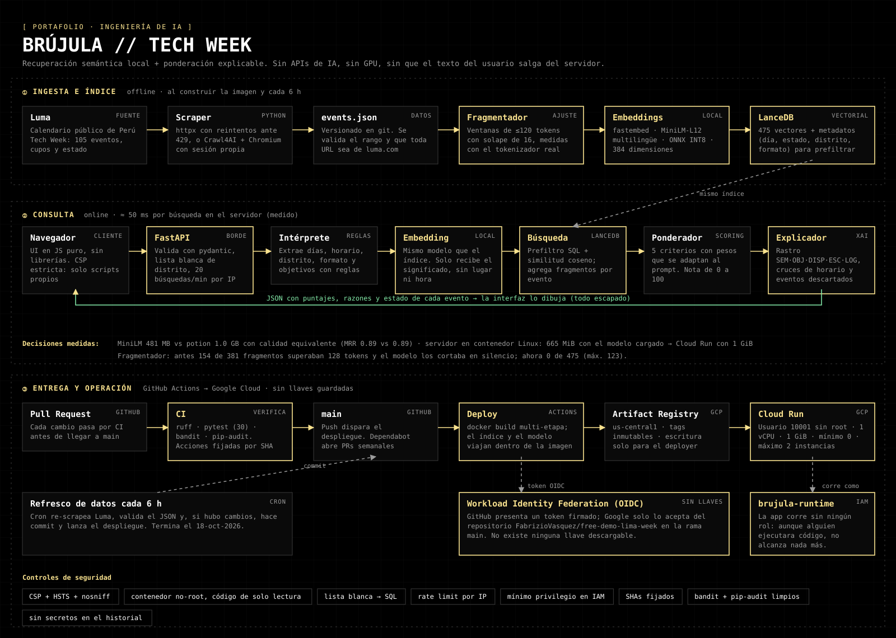
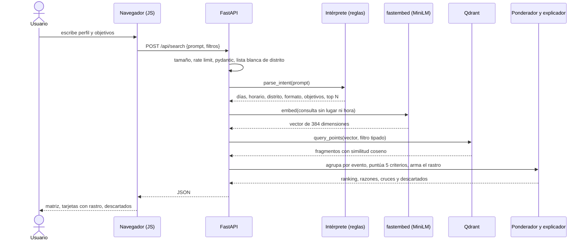

# Arquitectura

## Componentes

| Módulo | Responsabilidad | Herramienta | Por qué esta y no otra |
|---|---|---|---|
| `scrape.py` | Descarga los eventos de Luma | `httpx` · `Crawl4AI` (opcional) | httpx es rápido y sin navegador; Crawl4AI cubre el caso en que Luma exija sesión |
| `index.py` | Fragmenta por tokens y escribe el índice | `tokenizers` | Medir con el tokenizador del modelo evita que el texto se corte en silencio |
| `embed.py` | Texto → vector de 384 dimensiones | `fastembed` (ONNX INT8) + `paraphrase-multilingual-MiniLM-L12-v2` | Local, multilingüe, 481 MB, sin API ni GPU (ver *Decisiones*) |
| `index.py` / `search.py` | Búsqueda vectorial con filtro | **Qdrant** (modo local) | Embebida, sin servidor, filtros tipados (sin SQL) y muy liviana; ideal para ~500 vectores |
| `search.py` | Intérprete, ponderador y explicador | Python puro | Reglas auditables: cada nota se puede explicar con una frase |
| `server.py` / `security.py` | API, validación, límites, cabeceras | `FastAPI` · `pydantic` | Validación declarativa y 422 automático |
| `static/` | Interfaz | HTML + CSS + JS sin librerías | Cero cadena de suministro en el navegador; CSP estricta |

## Esquema del índice (colección `event_chunks`)

Cada punto es un fragmento de un evento: un **vector** de 384 floats (distancia coseno) más un *payload* con los datos para filtrar y mostrar.

| Campo del payload | Tipo | Uso |
|---|---|---|
| `event_id`, `chunk_no` | texto, entero | Agrupar fragmentos por evento |
| `body` | texto | Fragmento sin cabecera, para mostrarlo como evidencia |
| `start_ts`, `end_ts` | entero (segundos Unix, hora de Lima) | Filtros por día y por "ya terminó"; Qdrant filtra rangos con números |
| `status`, `city`, `mode` | texto | Filtros de estado, distrito y formato |

## Ciclo de una consulta

## Cómo se calcula la nota

`total = Σ (peso_i × nota_i) / 100 × 10`, con notas de 0 a 10 y pesos que suman 100.

| Criterio | Qué mide | Peso base |
|---|---|---|
| Afinidad semántica | Similitud coseno (mitad absoluta, mitad relativa al conjunto) | 45 |
| Calce con tu objetivo | Señales del evento (workshop, hackathon, venture…) frente a lo que pediste | 20 |
| Disponibilidad | Abierto, lista de espera, agotado, aprobación, cupos | 15 |
| Alcance de la comunidad | Inscritos en escala logarítmica | 10 |
| Logística | Horario, distrito, formato; penaliza eventos fuera de Lima | 10 |

Los pesos se adaptan: sin objetivos explícitos el peso de *objetivo* pasa a *semántica*; con restricciones de lugar u horario *logística* sube a 15; "networking" sube *alcance*; "empleo" sube *objetivo*.

## Decisiones

**Embeddings locales en lugar de una API.** Consultar un modelo remoto envía el texto del usuario a un tercero y cobra por uso; aquí el único coste es el cómputo de una consulta de ~4 ms. Se midieron dos candidatos sobre 15 consultas con respuesta conocida (`scripts/bench_embeddings.py`):

| | MiniLM-L12 (elegido) | potion-multilingual-128M |
|---|---|---|
| Calidad (MRR) | 0.894 | 0.889 |
| Peso del modelo | **481 MB** | 1.0 GB |
| Memoria tras cargar y consultar | **881 MB** | 1.2 GB |
| Latencia por consulta | 3.6 ms | 0.2 ms |

La latencia no es el factor de coste (Cloud Run factura por tramos de 100 ms); sí lo son el tamaño de la imagen, el arranque en frío y la memoria, donde gana MiniLM. Con 15 consultas la diferencia de calidad es ruido.

**Qdrant en modo local en lugar de LanceDB, Chroma, FAISS o pgvector.** Primero se usó LanceDB; al medir la imagen, LanceDB + PyArrow ocupaban 310 MB (59 % de las librerías) para guardar 475 vectores. Con Qdrant local el entorno de Python bajó de **532 MB a 193 MB** y la imagen de **941 MB a 612 MB**. Además los filtros son objetos tipados, así que no hay texto SQL que pueda inyectarse. Con cientos de vectores la búsqueda exacta es instantánea; no hace falta un índice aproximado.
Limitación conocida: el modo local está pensado para colecciones pequeñas (decenas de miles de puntos como mucho) y necesita escribir un archivo `.lock`; por eso al arrancar se abre una **copia** del índice (~2 MB) en `/tmp`, lo que permite una imagen de solo lectura. Si el catálogo creciera mucho, el siguiente paso sería un servidor de Qdrant.

**Reglas en lugar de un LLM para explicar.** Cada frase del rastro sale de un cálculo verificable, no de texto generado. Evita alucinaciones y el coste por consulta. El límite es la comprensión del lenguaje: el intérprete reconoce lo que sus reglas cubren.

**El índice se construye al construir la imagen.** El arranque no descarga el modelo ni calcula nada, y el contenedor corre con `HF_HUB_OFFLINE=1`.

## Límites conocidos

- El intérprete es de reglas: "tardes" y "Surco" se entienden; paráfrasis raras no.
- Un texto ajeno al evento puede no activar el aviso de baja confianza (umbral de similitud 0.40).
- 15 consultas de evaluación sirven para comparar modelos, no para afirmar una precisión general.
- El límite de tasa es por instancia de Cloud Run; el tope de gasto lo pone `--max-instances=2`.
